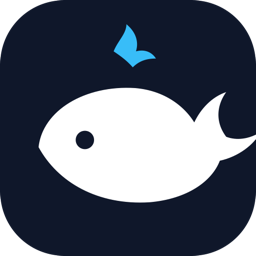
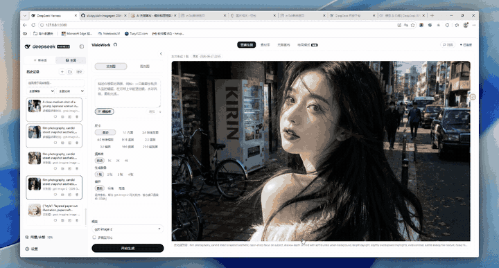
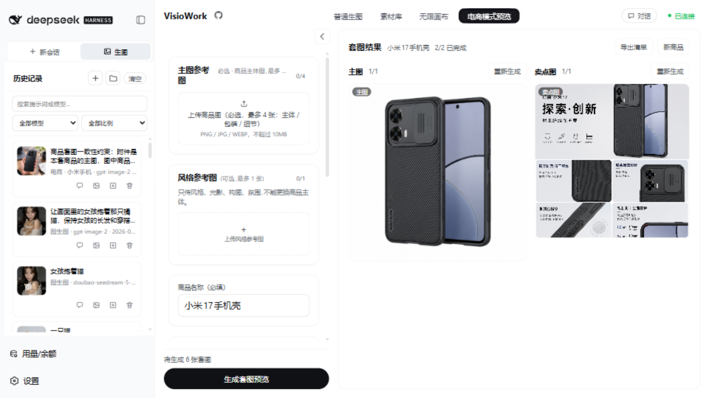
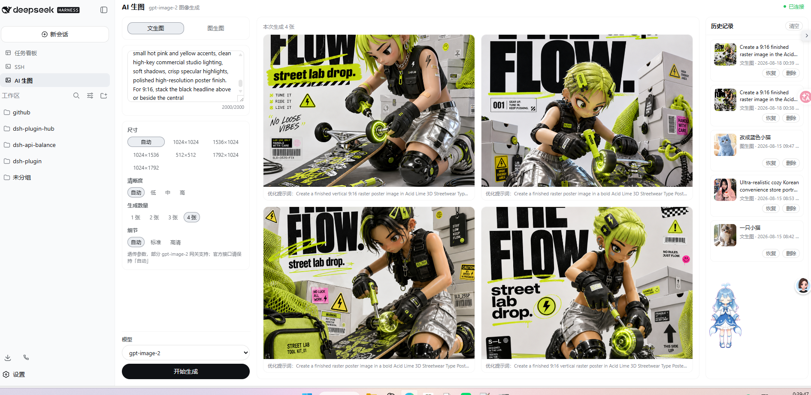
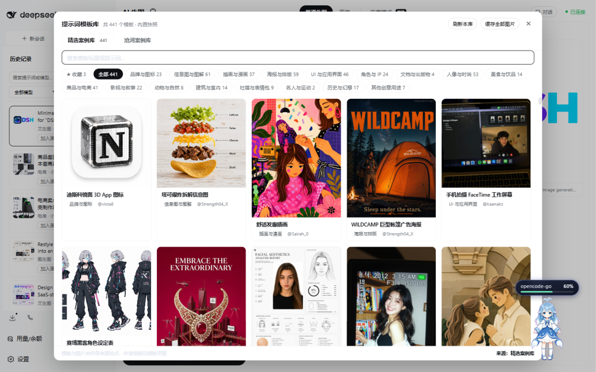
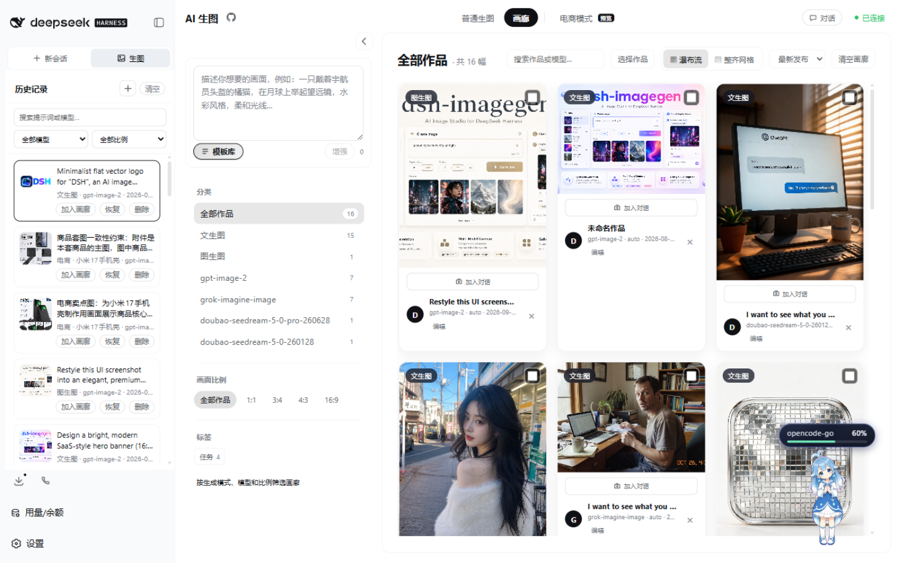

# dsh-imagegen-video

> **图片与视频一体化的 DSH 生图 / 生视频插件。**
> 生图之外，本仓库提供**完整的生视频链路**，以及**画布视频节点、片段拼接**。
> 各版本的改动见 [CHANGELOG.md](./CHANGELOG.md)，第三方代码归属见 [NOTICE](./NOTICE)。

<div align="center">
  <a href="https://github.com/q253595422/dsh-imagegen-video/releases"></a>
  &nbsp;
  <a href="https://github.com/q253595422/dsh-imagegen-video/releases"></a>
  &nbsp;
  <a href="./LICENSE"></a>
  &nbsp;
  <a href="https://github.com/q253595422/dsh-imagegen-video"></a>

  <p><strong>在 DeepSeek Harness 里，生成、编辑、管理，一站完成；图片与视频同一套工作流。</strong></p>
  <p><strong>快速导航</strong></p>
  <p><a href="#quick-start">🚀 快速开始</a>　·　<a href="#canvas">无限画布</a>　·　<a href="#compose">片段拼接</a>　·　<a href="#ecommerce">电商套图</a>　·　<a href="#txt2img">文生图 / 图生图</a>　·　<a href="#txt2video">生视频</a>　·　<a href="#gallery">模板 / 画廊</a>　·　<a href="#configuration">模型配置</a>　·　<a href="#community">交流群</a>　·　<a href="#license">授权与致谢</a></p>
</div>

<a id="sponsor"></a>
## 赞助商

| 赞助商 | 简介与接入地址 |
| :---: | --- |
| <a href="https://api.closeai.hk/"></a> | **[椰子API](https://api.closeai.hk/)** — OpenAI 兼容的多模型网关。一个 API Key 同时覆盖 GPT Image 与 Gemini 图像模型，不必分别注册各家；在插件里就是一个普通渠道，不需要改代码。<br><br>`https://api.closeai.hk/v1` · Bearer API Key |
| <a href="https://api.metajing.cn/"></a> | **[清衍 API](https://api.metajing.cn/)** — 面向国内开发者的 AI API 中转站，站点自述支持 Claude、GPT、Gemini 等模型。<br><br>`https://api.metajing.cn/v1` · `Authorization: Bearer <key>` |
| <a href="https://github.com/ChisaAlter/WhaleIsle"></a> | **[鲸屿 Whale Isle](https://github.com/ChisaAlter/WhaleIsle)** — 基于 DeepSeek Harness 的开源社区桌面客户端：AI 对话、终端与 Git、模型与 MCP 接入、主题壁纸与桌宠、用量统计，装好即可把本插件跑在桌面上。<br><br>Windows x64 · macOS Apple Silicon · MIT |
| <a href="https://github.com/jev-chat/jev-chat-jarvis"></a> | **[jev-chat](https://github.com/jev-chat/jev-chat-jarvis)** — 聊天辅助决策工具：回复前先读懂对方意图与当下风险，再给出可一键填入的草稿，发不发由你。Android · Windows · macOS · iOS，MIT。<br><br>官网 `chatjevs.com` |
| <a href="https://mrday.one/"></a> | **[Mr. Day One](https://mrday.one/)** — AI 原生编辑器，把仓库、终端和诊断信息接进同一条智能体回路：改代码、跑测试、读报错、再复审结果。<br><br>`https://mrday.one` |
| <a href="https://harnesscatalog.com/"></a> | **[Harness Catalog](https://harnesscatalog.com/)** — DeepSeek Harness 插件目录：逐个评测、给出真实安装命令，并说明什么场景该用它。本项目已收录其中。<br><br>[dsh-imagegen-video 条目](https://harnesscatalog.com/plugins/dsh-imagegen-video/) |
| <a href="http://82.157.4.13/"></a> | **[莱昂 LEON](http://82.157.4.13/)** — AI 电商操盘手 × GEO 顾问：把电商一线经验蒸馏成可审计的方法论与 AI 工作流，提供 GEO 品牌托管、电商方法论体系搭建与多智能体工作流定制。<br><br>点击名称或徽章访问站点 |

> **以上是赞助位，不是中立推荐。** 七项均由第三方独立维护：两家 API 网关的
> 可用模型、价格、限流与稳定性，桌面客户端、移动应用与编辑器的兼容性、稳定性
> 及其使用条款，顾问站点的服务内容与交付承诺，以及插件目录的收录与评价，均以
> 各自站点公告为准，本项目不做担保。配置网关后密钥会发送给对应服务，请按需
> 自行评估；不要用它们处理你不愿意交给第三方的内容。

<a id="quick-start"></a>
## 快速开始

需要已安装 [DeepSeek Harness](https://github.com/deepseek-ai/DeepSeek-Harness) 和 Node.js 20+。

安装包有两个来源：**npm registry**（推荐，包名即版本，`npm view` 能查、能被锁文件盯住）与 **GitHub Release 资产**（每次附带 `SHA256SUMS`）。

```bash
# npm（registry 直达）
dsh plugin --profile web add @q253595422/dsh-imagegen-video

# 或 GitHub Release 资产
dsh plugin --profile web add https://github.com/q253595422/dsh-imagegen-video/releases/download/v1.15.2/q253595422-dsh-imagegen-video-1.15.2.tgz
```

也可以先到 [Releases](https://github.com/q253595422/dsh-imagegen-video/releases) 页面下载 `.tgz`，再安装本地文件：

```bash
dsh plugin --profile web add ./q253595422-dsh-imagegen-video-1.15.2.tgz
```

> ⚠️ **不要与 `@dickpy/dsh-imagegen` 同时安装。** 两者注册的是同一套
> `/api/dsh-imagegen/*` 路由和同一个 UI 面板，同时启用会冲突。数据目录
> `~/.dsh/dsh-imagegen/` 也是两者共用的，切换前请先备份。详见 [授权与致谢](#license)。

安装后重启 `dsh web`，侧边栏会出现「生图」入口。到「设置 → 生图配置」添加提供方、填写 API 地址与密钥、检测并选择生图模型，保存后即可开始创作。Windows 若遇 PowerShell 脚本策略限制，请使用 `dsh.cmd`。

<details>
<summary><b>其他安装方式、升级与回滚</b></summary>

- **让 Agent 安装：**把上面的安装命令发给 DSH、Codex 或其他 coding agent。
- **指定版本：**把 URL 里的 `v1.15.2` 与文件名里的版本号换成目标版本，或从 [GitHub Releases](https://github.com/q253595422/dsh-imagegen-video/releases) 下载对应版本的 tgz 后安装。
- **升级：**重复执行 `add` 命令指向新版本即可；插件也会在面板中提示新版本。更新后重启 `dsh web`。
- **DSH Desktop 用户：**宿主 CLI 不允许写入 `desktop` 这个 profile，所以面板不会假装去更新，而是直接给出可复制的命令和下载地址，由你自己执行——不会只甩一句「更新失败」而没有原因。
- 渠道配置、历史记录和画廊数据保存在 DSH 宿主侧，正常升级不会清空。

</details>

<a id="features"></a>
## 核心功能

| 能力 | 用途 |
| --- | --- |
| **无限画布** | 把提示词、参考图和生成节点连成可迭代的创作流程。 |
| **视频节点与拼接** | 视频节点与图片节点同一套控制；多选后按画布位置拼成一条成片。 |
| **分镜节点** | 一列镜头各出一段视频，可接上一镜尾帧；成品就是普通视频节点，同样能拼接。 |
| **时间线与身份锚定** | 成片可以在时间线里排序、裁剪、加转场再拼；钉住的角色/物品会跟着后续每一次生成。 |
| **电商套图** | 从商品参考图生成主图、卖点图、场景图等成套素材。 |
| **文生图 / 图生图** | 使用兼容的生图渠道生成、编辑并比较图片。 |
| **生视频** | 文生视频、图生视频、首尾帧与多参考图；按协议族适配异步渲染与轮询。 |
| **代码生成** | 让 DSH 里已有的对话模型写绘图程序，本机渲染成视频或图片；不调生图/生视频模型，每个任务单独选。 |
| **对话与 Agent** | 在 DSH 对话中生成图片、继续编辑，并把结果带回会话。 |
| **画廊与历史** | 图片与视频同列管理，支持模板与标签；在不同设备上接续创作。 |

<a id="canvas"></a>

把文字、图片和生成配置连起来；从历史或画廊加入素材，再继续生成和迭代。

<div align="center">
  
</div>

<details>
<summary><b>画布、文件节点与技能细节</b></summary>

- 支持图片、文本、视频、生成配置、文件与**分镜**节点；图片节点可标注、移除背景或拆分图层。
- **分镜**：一个节点就是一列镜头，每镜一条提示词与一个时长，顺序即片序。可以「每镜独立」一次提交全部待生成的镜头，也可以「接上一镜尾帧」一次跑一镜——用上一镜的最后一帧当这一镜的第一帧。每一镜的成品都是普通视频节点，预览、下载、收藏、重试和拼接都走原来那条链路；分镜自己有「拼接全部镜头」，交给同一套本机 ffmpeg 和同一张顺序确认卡。
- **时间线**：画布底部的胶片按钮把选中的成片按阅读顺序排成一条，可以重排、逐段设入点/出点、给每条接缝选硬切 / 叠化 / 淡入淡出并调时长，也可以整体关掉声音。面板上显示的总时长与最终文件一致。
- **身份锚定**：任意有图的图片节点右键「钉为身份参考」，选角色 / 物品 / 风格并起名。之后每一次图像与视频生成都会自动带上这些参考，提示词里补一句说明谁是第几张；连线仍然优先，二者去重合并。定义存在节点上，重拍那张图就能改脸。
- **取尾帧续拍**：任意已完成的片段可以一键取结尾帧，落成图片节点并接好一个视频配置节点，直接写下一镜的描述就能接着拍。
- **海报编辑**：在图片节点上叠加文字与 Logo 图层，拖动改位置，实时预览；导出是一张新图片节点，原图与图层配方都保留，随时可以重开继续改。整条链路纯本地 Canvas 2D，不调用任何模型、不消耗额度。
- **快捷键面板**：按 `?`（或 `F1`）随时呼出，或点工具栏的键盘图标；`Esc` 关闭。常用操作同时写在控件自身的提示里（如「撤销 (Ctrl+Z)」），不必先记住有这块面板。
- 单个文件最大 50MB；可在画布内预览常见文档、表格、PDF、图片与音视频。
- 内置文本润色、图片描述、内容抽取和图片转可编辑 PPT 等技能；图片转 PPT 不需要另外安装第三方技能或配置 OCR token。
- 图片转 PPT 使用配置的聊天模型理解版式，在本地生成可编辑文字与基础矢量形状；复杂照片或插画可能会简化。
- 也可安装和管理外部技能。重任务技能会启动具有本机文件读写与命令执行能力的无头 Agent；运行前请检查技能来源和权限。
- 旧版第三方 `image-to-editable-ppt` 可继续用于独立 Agent 工作流；它不参与内置图片转 PPT，相关 OCR 或图片后端配置也不是内置流程的前置条件。
- 技能配置格式与安全边界见 [`docs/skill-config.md`](docs/skill-config.md)。

</details>

<a id="compose"></a>
### 片段拼接

把生好的视频片段拖到画布上，**框选两段以上**，底部会出现「拼接这 N 段」按钮。

- **顺序按画布位置**：从上到下、从左到右；每个被选中的片段上会标出 ①②③，确认卡里也会列出最终顺序 —— 你看到的序号就是成片里的顺序。
- **本机 ffmpeg 执行**：不调用任何模型、不联网、不消耗额度。工具从 `~/.local/bin`、`/opt/homebrew/bin`、`/usr/local/bin`、`/usr/bin` 依次查找；找不到时按钮会明确说明原因，而不是静默失败。
- **成片进入视频历史**：拼接结果作为一条普通视频记录落盘，可以在侧栏看到、播放，也可以收藏进素材库。
- 找不到的片段会让**整次拼接失败**并指出是第几段，而不是悄悄少拼一段。
- **要剪再接就用时间线**：底部胶片按钮打开时间线，逐段裁剪、选转场、决定是否保留声音，再一次性交给同一条 ffmpeg 链路。不设时间线时行为与以前完全一致（整段、硬切、带音轨）。
- 输出统一为 1280×720 / 30fps / H.264 + AAC，不同尺寸或帧率的输入会等比缩放并补边，不会变形。

判定规则与已知边界见 [`docs/compose-contract.md`](docs/compose-contract.md)。

分镜节点也有自己的「拼接全部镜头」：它把各镜已经生成的片段按镜头顺序交给同一条链路，
还在生成的镜头会被跳过并说明少了几镜。

<a id="ecommerce"></a>

从商品主体和可选风格参考出发，先预览套图计划、逐张调整提示词，再批量生成；主图可作为其他用途图片的一致性参考。

<div align="center">
  
</div>

<a id="txt2img"></a>

输入提示词即可生成，也可上传参考图进行编辑。图生图支持**多张参考图**（最多 5 张，单张 10 MiB、合计 16 MiB）：可多选、拖拽或粘贴，逐张移除，缩略图里用方向键翻看。请求形状按协议族各自整形——第一张始终在 `image`，其余在 `images`，所以只接受单张的渠道看到的仍是一张图；面板会在提交前就按模型能力拦下超额张数，而不是让服务端默默截断。此外支持多张结果、比例与清晰度设置、任务队列、历史恢复和全屏预览。

<div align="center">
  
</div>

在 DSH 对话里可让 Agent 调用生图；用 `/edit_image` 描述修改内容，也可从工作台或画廊把图片加入当前会话继续编辑。

<a id="txt2video"></a>

### 生视频

在「生视频」标签页里写视频描述，选择视频模型、比例、分辨率与时长即可提交。视频是**异步渲染**：宿主先提交任务、再按协议族轮询，渲染完成后把成片以文件落盘，并在面板内直接播放；渲染通常需要数分钟，期间可以关闭页面，任务仍在宿主继续执行。

**视频模型按渠道单独配置**，与图片模型分开：渠道里的「视频模型」目录决定该渠道能用哪些视频模型，因为视频走的是提交+轮询协议，和图片的同步返回不是一回事。

#### 先规划（导演规划）

视频面板的**先规划**开关默认打开。开启后，提交前会先跑一轮推理，把一句话需求拆成镜头、动作、运镜、时长与风格，再落成真正发给模型的提示词与参数：

- **提示词**：上游收到的是规划后的多镜头描述，而不是你输入的原句。结构参照 Wan 2.2 官方 `--use_prompt_extend` 的电影语言（景别、光线、运镜、风格），在「生成前先规划」之后，原句只作为素材。
- **参数**：时长、画幅、分辨率可以按镜头节奏收紧，但**永远不会超过你自己选的值**；规划提出的画幅/分辨率还会再按模型协议族收敛一次（例如算力萌只接受 16:9 / 9:16 / 1:1）。
- **可检查**：点「预览规划」不消耗渲染，只运行规划本身；确认后提交会**沿用这份预览**，不会重新问一次对话模型，所以所预览即所提交。
- **降级有据**：对话模型调用失败、超时或返回的不是合法 JSON 时，会自动改用离线镜头规划，并在面板与视频历史里标明降级原因与来源（`对话模型` / `本地规则`），不会静默地把原句发出去。
- **拒绝非法输入**：空描述直接报 `video-prompt-empty`；超过 4000 字符报 `video-prompt-too-long`，且都不会提交到上游。

规划用的对话模型复用「设置 → 提示词增强模型」那一处配置（`promptModel` / `promptApiUrl` / `promptApiKey`），**不需要额外申请密钥**：

- `promptModel`：任意支持 `/chat/completions` 的模型；留空时退回本地规则规划。
- `promptApiUrl` / `promptApiKey`：留空时复用生图渠道的地址与密钥。
- 规划阶段失败只降级、不会中断渲染；渲染本身失败仍按原有报错返回。

代码落点：`src/video-director.ts`（规划与参数收敛）、`src/generation-runtime.ts`（接入 `runVideo`）、`POST /api/dsh-imagegen/video/plan`（预览）。对应离线检查：`pnpm run test:director`。

<details>
<summary><b>支持的协议族与模式</b></summary>

| 协议族 | 模型示例 | 说明 |
| --- | --- | --- |
| Agnes 视频 | `agnes-video-2.5-flash`、`agnes-video-2.5` | 提交 `POST /v1/videos`，轮询 `GET /v1/videos/{id}`，取 `metadata.url`；支持文生视频、首尾帧、多参考图、`seed`。 |
| 火山 Seedance（方舟） | `doubao-seedance-2-0-260128`、`doubao-seedance-2-0-fast-260128`、`doubao-seedance-1-0-pro-250528` | 方舟原生任务协议：提交 `POST /contents/generations/tasks`，轮询 `GET /contents/generations/tasks/{id}`，成片在 `content.video_url`。提示词与参考图放在 `content` 数组里（参考图带 `role`：`first_frame` / `last_frame` / `reference_image`），比例字段是 `ratio`，分辨率小写。时长：2.x 为 4–15 秒、1.0 为 2–12 秒。分辨率：2.0 支持 480p/720p/1080p/4k，`fast` / `mini` 只到 720p；1.0 为 480p/720p/1080p。1.0 不支持 `reference_image` 角色，`1.0 pro fast` 也不支持尾帧，面板会把这两种模式从该型号上收起来。 |
| 算力萌 comemoe | `wan2.2-t2v`、`zhimeng-h3-local` | `wan2.2-t2v` 仅文生视频；`zhimeng-h3-local` 支持图生视频。比例只接受 16:9 / 9:16 / 1:1；5 秒片子实测约 9 分钟。 |
| xAI Grok | `grok-imagine-video-1.5`、`grok-imagine-video-1.5-lite` | 提交 `POST /videos/generations`（注意不是 `/videos`），轮询 `GET /videos/{id}`，取 `video.url` 与 `video.duration`。 |
| 通用视频 | 其他视频模型 id | 按 OpenAI 兼容视频端点尽力适配；未识别的协议族会明确报错，不会静默发出错误请求。 |

- **生成模式**：文生视频、图生视频（单张参考图）、首尾帧（首帧+尾帧插值）、参考图（多张风格/主体参考）；不同模型支持的模式不同，面板只会给出该模型支持的选项。
- **成片存储**：视频保存在本机数据目录的 `videos/` 下，历史列表只存元数据，播放走支持 Range 的同源路由，所以可以拖动进度条。
- **Agent 调用**：Agent 可调用 `generate_video`（文生视频）与 `generate_video_from_image`（图生视频/首尾帧/参考图），并用 `get_video_generation_task` 查询进度；视频渲染较慢，不要紧凑轮询。

**火山方舟（Seedream / Seedance）** 的生图与生视频可以共用一个渠道（`https://ark.cn-beijing.volces.com/api/v3`），渠道里分别填图片模型与视频模型即可：

- **生图（Seedream）**：方舟的 `size` 只能是档位（`1K`/`1.5K`/`2K`/`3K`/`4K`）**或** `宽x高`，二选一，且没有 `aspect_ratio` 参数。所以选了具体比例时，插件按该模型的像素预算换算出显式的偶数宽高（例如 5.0 pro 在 16:9 / 4K 下是 `2784x1566`），这样比例才真的生效；`auto` 才回落到档位字符串。
- **水印**：生图的 `watermark` 默认是 **true**（右下角「AI生成」），插件每次都显式发 `watermark: false`。生视频的默认值是 `false`，插件同样显式发送，不依赖上游默认值。
- **音轨**：生视频的 `generate_audio` 默认是 **true**（2.5 / 2.0 才有这个字段）；面板没有音轨控制，插件显式发 `false`，1.0 系列则完全不带这个字段。
- **响应格式**：方舟的 Seedream 用 `response_format: 'url'`，插件随后回源下载；网关版的 Seedream 仍走 `b64_json`。
- **模型 ID**：请填方舟控制台的模型 ID（`doubao-seedream-*` / `doubao-seedance-*`）——协议族是从这个 id 前缀判断的。方舟的**推理接入点**（`ep-…`）目前无法判断协议族：图片会被当成通用渠道、生视频会在提交前直接报「协议族未知」而不是静默发一个形状错误的请求。要在接入点上用，请把该渠道的模型 ID 填成对应的方舟模型 ID。

</details>

#### 代码生成路径（不调生图/生视频模型）

画布合成栏里有一个「生成方式」下拉，两个选项：**模型生成**（默认，就是上面那整条链路）和**代码生成**。它**按任务选**，不写进设置、不做全局开关；同一个画布上这一张用模型、下一张用代码都行。

选「代码生成」时：

- **谁来画**：用 **DSH 里已经接入的对话模型**——就是你在对话面板里选中的那个模型，不是插件设置里的「提示词增强模型」，插件也不新增任何模型或密钥配置。宿主把这个请求当成一次无头对话：系统提示里给绘图 API 与约束，用户消息就是你的描述，模型返回一段 JavaScript 绘图程序。
- **谁来渲染**：本机 `node:vm` 沙箱逐帧执行这段程序，拿到 RGBA 像素后交给 ffmpeg 编码（视频）或直接写成 PNG（图片）。全过程不产生任何网络请求，也不消耗生图/生视频额度。沙箱里没有 `require`、没有 `process`、没有文件系统，只有一套绘图方法（矩形、圆、路径、渐变、文字等）。
- **参数照旧**：分辨率、比例、时长仍按合成栏选的档位生效（`480P`/`720P`/`1080P` × 比例，30fps），视频帧数 = 时长 × 30。同一套档位，代码路径不另立一套。
- **产物对等**：视频落进同一个 `videos/` 目录、同一条视频历史（条目带 `renderer: 'code'`），因此预览、下载、收藏、取尾帧、多选拼接、时间线裁剪与转场、工作流执行器全部照常；图片落进同一个 `images/` 与图片历史，可以继续做标注、海报编辑、当参考图。
- **模型会「答非所问」时降级**：如果模型返回的不是代码（比如直接回了一段说明），会改用内置标题卡渲染，任务标记 `degraded` 并记录原因——**照样出图/出片**，不会白跑一趟。真正无法继续的情况（语法错、运行时抛错、超时、缺 ffmpeg）才失败。
- **重试不重复问模型**：第一次生成的绘图程序存在任务里，重试会沿用它；想换一版再重新生成。

失败语义（错误码会直接显示在节点上，并附一行「可在上方「生成方式」里切回模型生成后重试」）：

| 错误码 | 含义 | 怎么办 |
| --- | --- | --- |
| `code-prompt-empty` | 描述为空 | 写一句画面描述（代码路径靠这句话绘图，不会自己编） |
| `code-prompt-too-long` | 描述超过 4000 字符 | 压缩到核心画面与文案 |
| `code-no-chat-model` | DSH 里没有选中的对话模型 | 在对话面板选一个模型，或切回模型生成 |
| `code-chat-failed` | 对话模型调用失败（鉴权、网络、上游报错） | 看节点上的原始原因；换模型或切回模型生成 |
| `code-not-code` / `code-syntax` | 模型返回的不是可执行代码，或代码编译不过 | 重试（会重新问模型），或切回模型生成 |
| `code-runtime` | 代码逐帧执行时抛错（报文里带第几帧） | 同上 |
| `render-timeout` | 整次渲染超过 120 秒 | 缩短时长或降分辨率后重试 |
| `render-no-ffmpeg` | 本机找不到 ffmpeg，无法编码视频 | `brew install ffmpeg`，或在设置里填 `FFMPEG_PATH`；图片不需要 ffmpeg |
| `render-cancelled` | 用户取消 | 重新提交即可 |
| `render-encoder-died` / `render-encoder-failed` | ffmpeg 进程异常退出 | 重试；持续失败请查 ffmpeg 是否可用 |

缺 ffmpeg 在**提交前**就会提示（合成栏下方一行黄色说明），不会等渲染到一半才报。

依赖只有 ffmpeg（视频路径；图片路径零依赖）。不引入任何新框架或原生模块。

</details>

#### 多模型对比

同一提示词可提交给多个模型并列查看结果，便于快速挑选风格与质量。

<div align="center">
  
</div>

<a id="gallery"></a>

提示词模板库内置八个来源（精选案例、沧河、手绘、Prompt/Signal、evolink、itgoyo、songtianlun、youart），共三千余条，可搜索、筛选、收藏并直接带入生图。模板库以**右侧抽屉**打开，约占工作区 75% 宽度：左边缘可拖动调宽（宽度记在本地），可一键铺满工作区，手机上自动全宽；搜索可限定当前来源或横跨全部来源；最近用过的 24 条留在「历史记录」里一键复用。选中的提示词可以**替换**输入框内容，也可以**追加**在后面。生成结果可在画廊中用标签和收藏继续整理；**删除是可撤销的**——被删的条目先进回收站，保留 30 天，期间可以逐条还原或一键清空，只有清空（或超过 30 天后的首次访问）才真正删除磁盘上的文件。

<p align="center">
  
  
</p>

<a id="configuration"></a>
## 模型配置

在「设置 → 生图配置」添加渠道，填写 API 地址与密钥，检测并选择生图模型。可配置多个提供方，并设置默认生图模型和可选的提示词增强聊天模型。

支持 OpenAI 兼容的 Images API / Chat Completions，以及 xAI Grok、Google Nano Banana、Seedream、Qwen-Image、GLM-Image、MiniMax 等预置渠道；也可手动添加兼容模型。

<details>
<summary><b>接口与渠道补充说明</b></summary>

- 通用渠道默认自动判断 Images API 与 Chat Completions；也可在设置中手动指定。
- One-API、New API、LiteLLM 等只暴露 `/chat/completions` 的网关，可填写完整接口地址并选择对应模型。
- API 密钥保存在 DSH 宿主设置中；未被自动识别的兼容模型可手动添加。
- 不同服务商的图生图、尺寸与返回格式可能不同，请确认所选模型实际支持的能力。

</details>

<a id="security"></a>
## 数据与安全

- API 请求经 DSH 宿主转发；密钥保存在本机设置中，不直接暴露给浏览器。
- 历史、画廊、画布和图片保存在 DSH 数据目录 `~/.dsh/dsh-imagegen/`，由你控制。
- 生图与图生图会把提示词或参考图发送给所配置的 API 服务商；请按服务商政策处理敏感内容。
- 内置轻量技能会把所选内容发送给配置的聊天模型。图片转 PPT 的 PPTX 在本地生成，由原生文字与基础矢量形状组成，不会把整张原图直接铺成幻灯片背景；结果需人工检查。
- 外部重任务技能可能读写本机文件并执行命令；运行前请确认技能可信、输入内容可共享。
- 生图会消耗 API 服务商额度；请人工检查生成结果。不要把 API 密钥贴到 Issue、日志或截图中。
- **诊断日志**（两个工作台右上角）：失败的 API 请求会留在本机内存里
  （最多 200 条，重启即清空，不写磁盘，不产生后台请求），
  可一键复制后贴进 Issue。记录含实际请求地址、HTTP 状态、网络错误码、耗时、
  体积与服务商原始响应；**密钥已在写入前脱敏**（`Bearer` 令牌、查询串密钥、
  内联 base64 均替换为占位符，API Key 只记「是否发送」）。
  生图与生视频写同一个缓冲：视频的提交 / 轮询 / 下载三条腿各自标记。

<a id="community"></a>
## 交流群

微信群「龙虾吹水🦞群」：使用问题、版本更新与画布玩法都可以在群里聊。

<div align="center">
  
</div>

> 二维码 7 天内有效（2026 年 11 月 1 日前）。过期或人数已满时，请改到
> [Issues](https://github.com/q253595422/dsh-imagegen-video/issues) 提问题，
> 并提醒维护者换一张新码。安全敏感的问题不要发在群里，也不要贴 API 密钥。

<a id="license"></a>
## 授权与致谢

本项目按 [Apache-2.0](./LICENSE) 发布。各版本的改动逐条列在
[CHANGELOG.md](./CHANGELOG.md)；第三方代码与素材的版权、许可与来源见
[NOTICE](./NOTICE) 与 [THIRD_PARTY_NOTICES.md](./THIRD_PARTY_NOTICES.md)。

**核心能力**：生图（文生图 / 图生图 / 多参考图编辑）、生视频（文生视频 / 图生视频 /
首尾帧 / 多参考图）、图片转可编辑 PPT（最多 12 张，每张一页）、无限画布（图片与视频节点、
分镜节点、片段拼接、技能）、电商套图、模板库与画廊。

**支持与问题反馈请提到本仓库的 Issues**（[Bug 报告](https://github.com/q253595422/dsh-imagegen-video/issues/new?template=bug_report.yml) · [功能建议](https://github.com/q253595422/dsh-imagegen-video/issues/new?template=feature_request.yml) · [全部 Issues](https://github.com/q253595422/dsh-imagegen-video/issues)）。

**与 `@dickpy/dsh-imagegen` 不能共存**：两者注册同一套 `/api/dsh-imagegen/*` 路由与
同一个 UI 面板，同时安装会冲突；数据目录 `~/.dsh/dsh-imagegen/` 也是共用的。要换回
原版，请先卸载本插件。

<details>
<summary><b>本地开发</b></summary>

```bash
pnpm run typecheck
pnpm run build
pnpm run watch
pnpm test
node scripts/smoke-video.mjs
pnpm run test:negative
```

`pnpm test` 跑全部离线检查（`verify-tracked` 排第一）；`pnpm run test:negative` 做反向验证——
把每处修复对应的缺陷重新注回**仓库副本**，要求对应检查变红，
工作树不被改动。时间线与身份锚定各有自己的纯函数套件，可以单独跑：
`pnpm run test:timeline`、`pnpm run test:cast`、`pnpm run test:timeline-compose`
（最后一个需要本机 ffmpeg，缺工具时明确跳过）。

跟进本项目的上游发布：

```bash
pnpm run upstream:check   # 有新版本时退出码为 1
pnpm run upstream:plan    # 生成移植报告到 .upstream/<版本>/report.md
pnpm run upstream:adopt v1.8.3   # 记录「已整合到哪个版本」
```

`upstream:plan` 会把每个改动文件按**能否干净应用到当前树**分类：新增（整份复制）、
可直接应用、冲突（需人工读）、本项目自有（视频链、发布说明、授权，不覆盖）。
它只生成报告，不改任何源码。这几个命令都是**手动**跑的——本项目不跟随上游版本线，
所以没有定时检测；要跟进时自己跑一次 `upstream:check`。

本地打包并安装到 DSH 验收：

```bash
pnpm pack --pack-destination .
dsh plugin --profile web add ./q253595422-dsh-imagegen-video-<版本>.tgz
```

仓库里的离线套件不需要网络与付费 API 调用；需要浏览器或 `ffmpeg` 的检查在缺
少工具时会**明确跳过并返回成功**，而不是伪装成失败。并行跑构建与测试请用
`./scripts/with-lock.sh`，它会把整棵工作树串行化。

</details>

## 许可证

[Apache-2.0](./LICENSE)

版权归属与第三方许可见 [NOTICE](./NOTICE) 与 [THIRD_PARTY_NOTICES.md](./THIRD_PARTY_NOTICES.md)。
